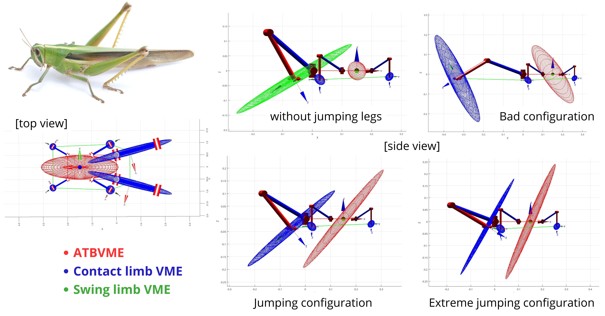

# grasshopper-dexterity-ellipsoid

A novel index of multi-limbed systems base (torso) dexterity has been evaluated for the bio-inspired case study of a jumping grasshopper.

<p align="center">
  
  <br>
  <em>Grasshopper Absolute Translational Base Velocity Manipulability Ellipsoid (ATBVME) in different (rear) jumping limbs configurations. Ellipsoids' colors represent different concepts: Red = system base/torso, Blue = limb in contact with the ground/active, Green = limb not in contact/not used in the motion.</em>
</p>

This repository report the software implementation (MATLAB) and mathematical implementation to reproduce the results presented on Chapter 3.3 of my Master's Thesis: [Motion Control and Manipulability Analysis of LIMBERO-GRIEEL: a Multimodal Limbed Robot for Unstructured Environments](https://github.com/AlePuglisi/master-thesis-multimodal-limbed-robot).

The **Base Manipulability Ellipsoid (BME)** is an index of dexterity of multi-limbed systems. This novel index represents quantitatively and graphically the ease of the multi-limbed kinematic system to translate/rotate their base in the 3D space, as function of the limbs' joints state. 
This index can be decomposed in Translational and Rotational. Additionally, it can be computed for the system differential kinematic (Absolute Velocity) or dynamics (External Force). 
For this case study, only the Absolute Translation Base Velocity Manipulability Ellipsoid (ATBVME) is considered as representative of jumping direction/magnitude of the grasshopper, given its limbs configuration. 

This mathematical theory extend the manipulability ellipsoid of robotic manipulators to the base of limbed systems. In fact, the BME index has been developed for robotics research, but I decided to evaluate it on a bio-inspired example, for the validation of its interpretability. Nature is always a source of inspiration and improvement...

Refer to My [Master's Thesis](https://github.com/AlePuglisi/master-thesis-multimodal-limbed-robot) (chapter 3) for further details. 

## Note (MATLAB -> Python)

I developed this framework in MATLAB during my Master's Thesis research, as the main programming language used in my University (POlitecnico di Milano). 
The code is highly dependent on the [robotics_toolbox](https://petercorke.com/toolboxes/robotics-toolbox/) by Peter Corke, which is also available as python package. <br/>
I want to migrate the scripts to a Python implementation, to make it usable without a MATLAB license...


## Quick Use 

Describe how to run basic analysis code and how to define your own kinematics

## Software Structure

Describe how to matlab scripts and functions are structured 

## How to Cite 

Please if you use some results or tools from this research, cite this work as:

```bibtex
@mastersthesis{puglisi2025limberogrieel,
  author    = {Puglisi, Alessandro},
  title     = {Motion control and manipulability analysis of {LIMBERO-GRIEEL}: a multimodal limbed robot for unstructured environments},
  school    = {Politecnico di Milano},
  year      = {2025},
  type      = {Master's thesis},
  note      = {Supervisor: Luca Bascetta. Co-supervisor: Kazuya Yoshida},
  url       = {https://hdl.handle.net/10589/235457}
}
```

## References and Acknowledgments

The implementation of this work has been possible thanks to the incredible [robotics_toolbox](https://petercorke.com/toolboxes/robotics-toolbox/) by Peter Corke ([Pyhton GitHub](https://github.com/petercorke/robotics-toolbox-python0) - [MATLAB GitHub](https://github.com/petercorke/robotics-toolbox-matlab))

```bibtex
@ARTICLE{pcorke_rtb_m,
  author={Corke, P.I.},
  journal={IEEE Robotics & Automation Magazine}, 
  title={A robotics toolbox for MATLAB}, 
  year={1996},
  volume={3},
  number={1},
  pages={24-32},
  doi={10.1109/100.486658}
}
```

```bibtex
@inproceedings{pcorke_rtb_py,
  title={Not your grandmother’s toolbox--the Robotics Toolbox reinvented for Python},
  author={Corke, Peter and Haviland, Jesse},
  booktitle={2021 IEEE International Conference on Robotics and Automation (ICRA)},
  pages={11357--11363},
  year={2021},
  organization={IEEE}
}
```


